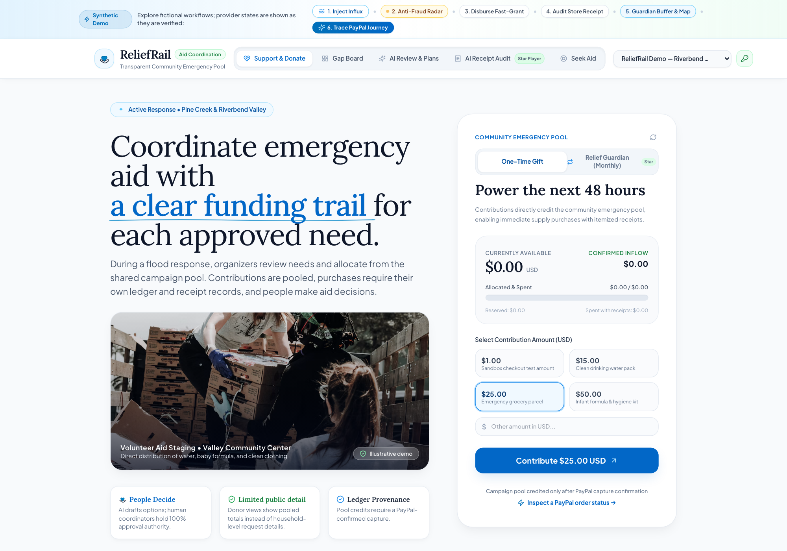
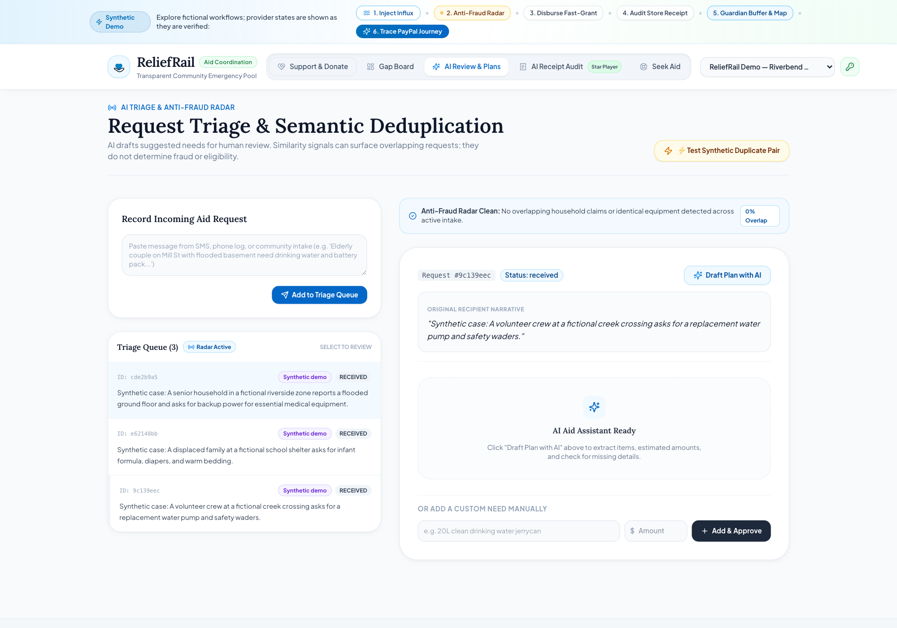
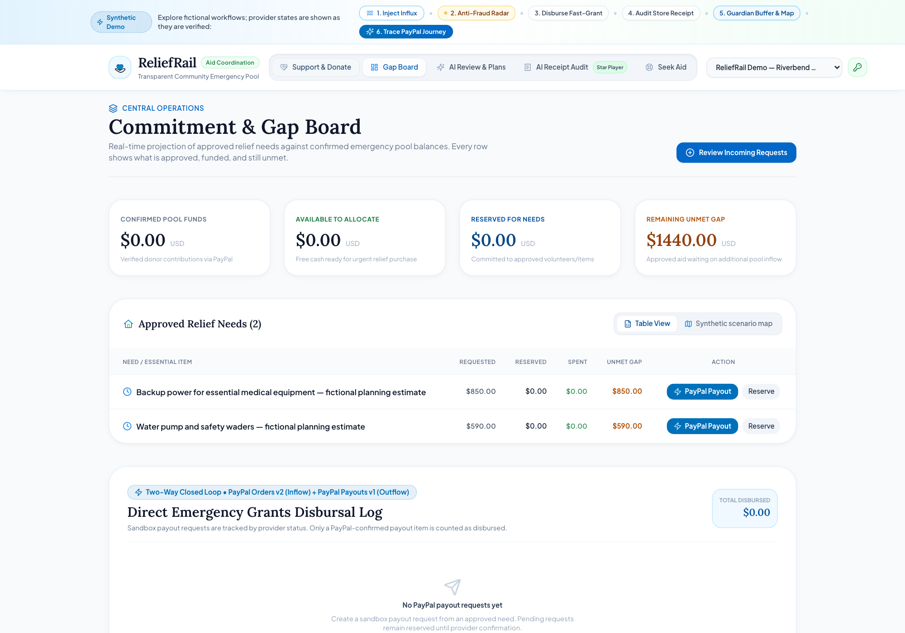
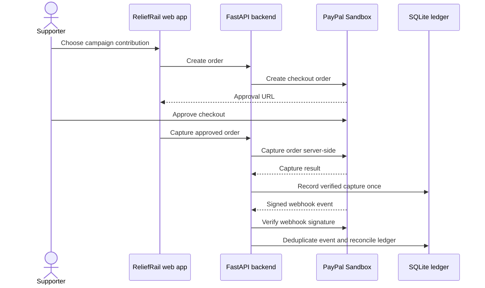
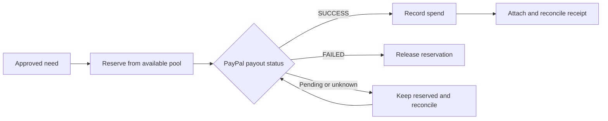
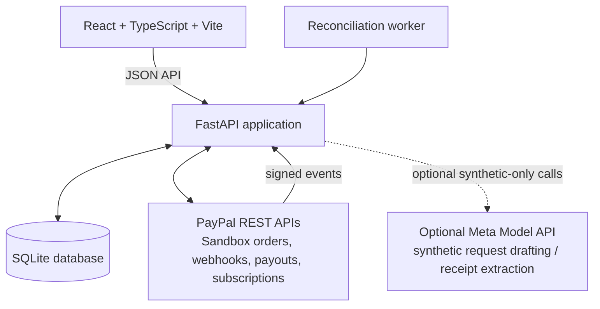

# ReliefRail

<p align="center">
  
</p>

<h1 align="center">ReliefRail</h1>
<p align="center"><strong>Turn community relief funds into a clear, accountable path from need to fulfillment.</strong></p>
<p align="center">A human-controlled disaster-relief coordination prototype integrating PayPal Sandbox payments, a shared assistance pool, request triage, and fulfillment tracking.</p>

<p align="center">
  
  
  
  
</p>

> **Prototype boundary:** ReliefRail is an experimental coordination product, not an emergency-response service or a production financial platform. Payment flows are configured for PayPal Sandbox. Screenshots below use synthetic demo records; the hero photograph is illustrative stock imagery, not ReliefRail field activity. Do not enter real recipient data or use this project to make eligibility, fraud, or emergency-safety decisions.

## The problem

During a disaster, requests, donor contributions, purchasing decisions, and delivery updates often travel through separate spreadsheets, messages, and payment tools. Coordinators can struggle to see which needs are approved, what the shared pool can cover, what has been reserved, and whether a payout or receipt has actually been reconciled. That makes it harder to coordinate quickly and explain how funds moved.

ReliefRail prototypes a single, auditable workflow: collect and review requests, express approved needs as costed line items, accept contributions into a pooled balance, reserve funds before fulfillment, and reconcile the final outcome against provider events and receipts. Humans remain responsible for review and approval.

## Product at a glance

| Capability | What the prototype does | Important boundary |
|---|---|---|
| Relief request coordination | Organizer queue, recipient status/clarification flow, needs and approval state | It does not determine who qualifies for aid |
| AI-assisted drafting | For explicitly synthetic demo requests, proposes a structured draft with estimates, questions, and uncertainty | Suggestions only; external AI is blocked for ordinary real requests; humans review every draft |
| Shared pool accounting | Tracks contributions, reservations, spends, releases, and refunds as separate ledger entries | Not a bank account, custody product, or donor-restricted allocation engine |
| PayPal contribution flow | Creates a Sandbox order, captures it server-side, validates webhook signatures, and records payment events | Sandbox only; no live-money claim |
| Payout lifecycle | Starts a PayPal Sandbox payout after a reserve and reconciles provider state before recording spend | Provider acceptance is not delivery confirmation; unresolved payouts remain pending for reconciliation |
| Receipt review | Extracts receipt details where configured, applies deterministic checks, and supports human review and reconciliation | OCR/model output can be wrong; it is not an audit certification |
| Duplicate assistance radar | Highlights potentially similar requests for coordinator review and supports controlled merging | Similarity is not fraud detection or an eligibility decision |
| Readiness and operations views | Pool/gap board, supporter summary, exceptions, resource and subscription projections, synthetic map | Some views are illustrative or assumption-based; projections are not spendable cash |

## Product screenshots

These images were captured from the running interface using an isolated local demo database populated with synthetic records. The screenshots show product UI, not real recipients, field operations, or real funds.

<p align="center">
  
</p>
<p align="center"><em>Campaign overview. The banner photograph is illustrative stock imagery.</em></p>

<p align="center">
  
</p>
<p align="center"><em>Coordinator triage with a synthetic request. AI output remains a proposal for human review.</em></p>

<p align="center">
  
</p>
<p align="center"><em>Illustrative approved needs and funding gap from the isolated demo dataset; no cash is represented.</em></p>

## How a contribution moves through the system



The app records provider-backed payment state and keeps provider event processing idempotent. A contribution does not automatically pay a particular recipient: the pool is shared, and a coordinator must approve needs and initiate a reserve/fulfillment path.

## How fulfillment accounting works



Ledger entries use integer minor-unit amounts and distinct contribution, reserve, spend, release, and refund events. A simulated or unconfirmed transfer must not be presented as a completed real payout.

## AI and decision boundaries

ReliefRail uses AI as a drafting aid, not as an autonomous relief decision-maker.

- Synthetic requests can be used to demonstrate an external model integration when explicitly enabled.
- The model can propose itemized needs, rough cost estimates, follow-up questions, and uncertainty notes.
- A coordinator must inspect and approve any resulting need before it enters the fulfillment workflow.
- The product does not ask the model to decide eligibility, detect fraud, rank human worthiness, or authorize payments.
- Image/OCR extraction and duplicate similarity are fallible signals; they require human review.
- Subscription runway and replenishment views use assumptions and must be treated as projections, not actual cash or guaranteed future funding.

The current `.env.example` selects Meta Model API with `muse-spark-1.3`. External AI is disabled by default; configure a key only if you intend to run the synthetic demo. Never send real disaster-recipient data to an external model through this prototype.

## Architecture



| Layer | Implementation |
|---|---|
| Frontend | React, TypeScript, Vite, Tailwind CSS |
| Backend | Python, FastAPI, Pydantic, SQLAlchemy |
| Persistence | SQLite for local/demo use |
| Payments | PayPal Orders, webhook verification, Payouts and subscription APIs in Sandbox |
| AI integration | Optional Meta Model API; synthetic demo gating |
| Operations | Reconciliation worker, maintenance/backup and retention-redaction commands |

## Local setup

### Prerequisites

- Python 3.11 or newer
- Node.js and npm
- PayPal Developer Sandbox app credentials for payment-flow demonstrations
- Optional Meta Model API key for synthetic AI demonstrations

### 1. Configure the backend

From the repository root:

```bash
python -m venv .venv
source .venv/bin/activate
python -m pip install -r requirements.txt
cp .env.example .env
```

Set a strong local `BOOTSTRAP_SECRET` in `.env`. For a basic local run, SQLite and sandbox defaults are configured in the example file. Add the PayPal Sandbox client ID and secret to enable checkout. Keep `.env` private; never commit credentials.

Load environment variables and start the API:

```bash
set -a
source .env
set +a
uvicorn app.main:app --host 127.0.0.1 --port 8000
```

Open [http://127.0.0.1:8000/docs](http://127.0.0.1:8000/docs) for the interactive API reference. Bootstrap the first organization through the documented endpoint using the `X-Bootstrap-Secret` header, then save the returned admin token securely and create a campaign and member tokens.

### 2. Create an isolated synthetic showcase

In a second terminal, activate the same virtual environment and load `.env`, then run:

```bash
python -m app.demo_setup --confirm
```

This creates or reuses a separate demo organization/campaign with clearly synthetic requests and prints a one-time demo admin token. Rerunning rotates that token. The helper does not fabricate contributions, approvals, or successful payouts.

### 3. Start the frontend

```bash
cd web
npm ci
npm run dev -- --host 127.0.0.1
```

Open the local URL printed by Vite. Keep the backend running; the Vite development proxy forwards API requests to it.

### Optional AI-assisted synthetic demo

Set `ALLOW_SYNTHETIC_AI=true` and configure `META_MODEL_API_KEY` in your local `.env`. The AI drafting flow is intentionally limited to explicitly synthetic requests. Do not use real recipient information in this demo. Restart the backend after changing environment variables.

### Optional PayPal webhook testing

PayPal must be able to reach a public HTTPS webhook URL. Start the app locally, expose it through a trusted HTTPS development tunnel, then register the resulting `/paypal/webhooks` URL on the Sandbox app and set the webhook ID as `PAYPAL_WEBHOOK_ID`. Subscribe only to the event types the app handles. Keep the tunnel and webhook ID out of committed files. PayPal return URLs should use the local `RELIEFRAIL_APP_URL` during local checkout.

For delayed payout reconciliation, run the worker in another configured backend terminal:

```bash
python -m app.worker
```

## Demo walkthrough

1. Start the API and frontend; create or open the synthetic showcase campaign.
2. Inspect the request queue and open a synthetic request. Show the AI draft as a proposal, then review its questions and estimates as a human coordinator.
3. Approve a need and inspect the funding gap board. Point out that an approved need is not the same as a funded or paid need.
4. Create a PayPal Sandbox contribution order, approve it with a Sandbox buyer, and let the server capture it.
5. Show the payment journey and ledger entry. If webhook testing is configured, demonstrate the verified event and idempotent reconciliation.
6. Reserve funds for an approved need and initiate a Sandbox payout only when the test account configuration supports it.
7. Reconcile the provider status. Show that only a confirmed successful payout becomes spend, while failure releases the reserve and an ambiguous state remains pending.
8. Attach a synthetic receipt and review extraction/policy flags before reconciling it.

Avoid claiming each step succeeded unless the current environment has actually completed and recorded it. The screenshots in this README are synthetic UI examples, not evidence of a live transaction.

## API areas

The backend exposes OpenAPI documentation at `/docs`. Its route families cover:

| Area | Representative operations |
|---|---|
| Setup and access | Bootstrap, members, role-scoped tokens |
| Campaigns and reporting | Campaign pool, coordination board, audit view, supporter summary |
| Requests and needs | Request intake/listing, AI draft, need proposals, coordinator approval |
| Recipient portal | Status check, clarification, withdrawal where public intake is enabled |
| Payments | PayPal order creation/capture, webhook verification, payment history and journey |
| Fulfillment | Reserve, payout, reconciliation, retry, release, spend, refund accounting |
| Receipts | Scan/audit, human review/apply, attachment and reconciliation |
| Operations | Duplicate similarity, exceptions, resources, subscriptions, synthetic map clusters |

See `BACKEND.md` for deeper implementation and operational notes.

## Data protection and operational notes

- Local records may include sensitive needs and contact details. Use synthetic data for demos and protect database files and backups.
- Public recipient intake is disabled by default; enable it only in a controlled environment and review the consequences first.
- Use role-scoped member tokens, rotate/revoke tokens when needed, and keep provider secrets in environment variables.
- Backups and retention redaction are available through `app.maintenance`; follow the command's dry-run output before applying a redaction.
- The geographic view is illustrative/synthetic and must not be described as a privacy-certified or differential-privacy system.
- Local SQLite is for development and a single-instance prototype, not concurrent multi-region production operation.
- This repository does not establish legal compliance, payment-services authorization, disaster-response readiness, accessibility conformance, or independent security review.

## Current limitations and roadmap

ReliefRail is a substantial prototype, but it is not ready to operate real disaster relief. The current build is oriented around one local SQLite instance and PayPal Sandbox. It has no verified production-grade offline/SMS intake, local merchant inventory network, automated delivery confirmation, or live payment configuration. Some operational and geographic views are synthetic; forecasts rely on fixed assumptions. It has not completed an independent security, privacy, legal, accessibility, or disaster-operations assessment.

Before a real pilot, the project would need at least: threat modeling and security review; a production-grade persistence and deployment design; consent and retention policies reviewed with affected communities; incident response and access monitoring; accessible and low-bandwidth/offline workflows; payout and reconciliation runbooks; independent validation of accounting and operational controls; and a controlled pilot with experienced relief organizations.

## Development checks

Run backend tests from the repository root:

```bash
python -m pytest -q
```

Run frontend checks from `web/`:

```bash
npm run build
```

These checks help catch regressions; they do not replace provider Sandbox walkthroughs or a security/privacy review.

## Project structure

```text
app/                    FastAPI application, domain logic, persistence and worker
app/routers/            HTTP API route modules
tests/                  Backend unit and integration tests
web/src/                React application and interface components
web/public/screenshots/ Synthetic demo screenshots used by this README
BACKEND.md              Backend setup and implementation notes
.env.example            Safe configuration template (no secrets)
```

## Image attribution

The campaign overview screenshot includes an illustrative stock photograph served from [Unsplash](https://images.unsplash.com/photo-1593113598332-cd288d649433?auto=format&fit=crop&w=1200&q=80). It is used as visual placeholder imagery and does not depict a ReliefRail-supported operation. All other screenshot content is generated from synthetic demo records.

---

<p align="center"><strong>ReliefRail — coordinate needs, funds, and fulfillment with a traceable human-reviewed workflow.</strong></p>
